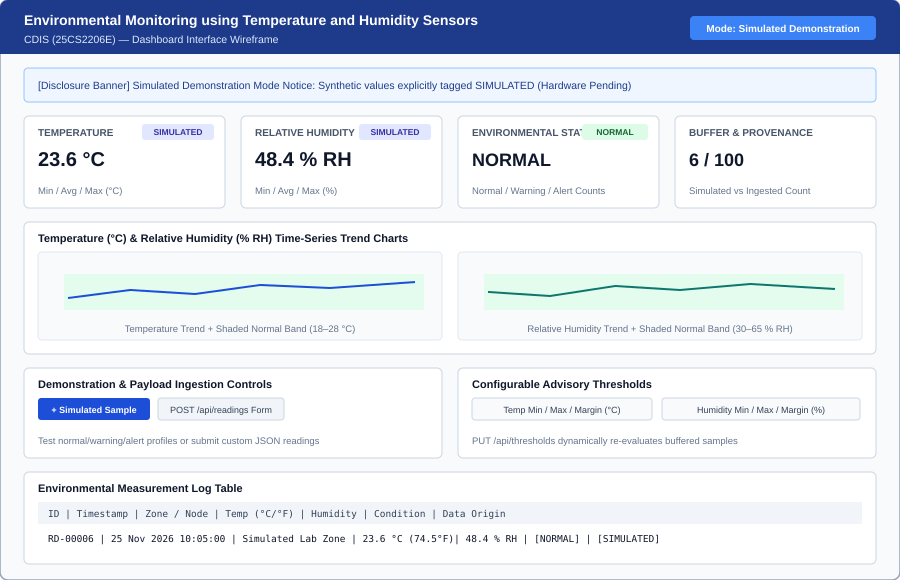

# Environmental Monitoring using Temperature and Humidity Sensors

**Course:** Cloud Infrastructure and Services (CDIS)

**Course Code:** 25CS2206E

**Team Number:** [TEAM NUMBER]

## Team Members

**Member 1**
- Full Name: [FULL NAME]
- Student ID: [STUDENT ID]

**Member 2**
- Full Name: [FULL NAME]
- Student ID: [STUDENT ID]

**Member 3**
- Full Name: [FULL NAME]
- Student ID: [STUDENT ID]

---

## 1. Project Introduction

Ambient temperature and relative humidity are foundational environmental parameters that directly influence occupant comfort, equipment reliability, laboratory repeatability, agricultural storage, and archival preservation. Traditional manual monitoring relies on periodic human inspection of wall-mounted hygrometers or isolated local displays, creating visibility gaps, transcription errors, and delayed responses when environmental conditions drift outside safe operating limits.

**Environmental Monitoring using Temperature and Humidity Sensors** is a modular, multi-tier software application developed for the **Cloud Infrastructure and Services (25CS2206E)** course. The system establishes a clean, vendor-neutral software foundation for collecting, validating, evaluating, displaying, and monitoring temperature and relative humidity measurements. In strict alignment with iterative engineering practice, the codebase decouples data acquisition and persistence interfaces so that physical sensor models, microcontrollers, database engines, and cloud service providers can be finalised by the project team in subsequent phases without refactoring core application logic.

Academic alignment for the current phase is intentionally scoped to **Course Outcome 1 (CO1 – Cloud Fundamentals and Architecture)** and **Course Outcome 2 (CO2 – Compute, Virtualization and Scaling)**.

---

## 2. Abstract

Monitoring ambient temperature and relative humidity continuously is essential across laboratories, server rooms, healthcare storage zones, and smart campus facilities. Conventional manual logging methods are labour-intensive, discontinuous, and incapable of providing immediate threshold advisories or centralised historical visibility. This project presents a modular, cloud-ready environmental monitoring software platform structured around a clean multi-tier architecture: a vendor-neutral **Data Ingestion and Sensor Adapter Layer**, a stateless **Application Processing and Threshold Evaluation Tier**, a pluggable **Storage Repository Layer**, and an accessible **Web Presentation Dashboard**. Incoming environmental payloads are validated against configurable physical plausibility bounds, normalised across Celsius and Fahrenheit scales, classified against user-configurable normal, warning, and critical alert thresholds, and visualised through real-time summary cards, SVG time-series trend charts, and provenance-tagged measurement logs. Prior to physical hardware integration, the application provides an explicitly labelled **Simulated Demonstration Mode** that clearly distinguishes synthetic software samples from external sensor measurements. Full abstract details are available in [`docs/project-reports/01-project-abstract.md`](docs/project-reports/01-project-abstract.md).

---

## 3. Problem Statement

Manual and non-networked approaches to temperature and relative humidity monitoring suffer from several operational and architectural limitations:

1. **Discontinuous Observation:** Periodic manual readings miss transient thermal spikes or humidity excursions occurring overnight, on weekends, or between inspection intervals.
2. **Delayed Anomaly Detection:** Without automated threshold evaluation, out-of-range conditions remain unnoticed until physical inspection occurs, risking sensitive equipment or stored materials.
3. **Manual Recording Errors:** Handwritten logs and spreadsheet transcription introduce human error, inconsistent timestamps, and incomplete audit trails.
4. **Lack of Centralised Visibility:** Standalone digital thermometers display readings only at the point of installation and cannot aggregate multi-zone telemetry remotely.
5. **Tightly Coupled Prototypes:** Many early monitoring prototypes hardcode sensor libraries, serial ports, credentials, and cloud SDKs directly into UI scripts, making hardware changes or cloud migration costly and error-prone.

See [`docs/project-reports/02-problem-statement.md`](docs/project-reports/02-problem-statement.md) for the complete problem analysis.

---

## 4. Project Objectives

1. **Design a Modular Multi-Tier Architecture:** Separate presentation, business/threshold processing, sensor ingestion, and persistence responsibilities in alignment with CO1 cloud architecture principles.
2. **Implement Vendor-Neutral Telemetry Validation:** Accept standardised JSON temperature and relative humidity payloads without assuming a specific sensor model or microcontroller platform.
3. **Provide Configurable Threshold Monitoring:** Evaluate every reading dynamically against configurable normal, warning, and critical alert boundaries for both temperature (°C) and relative humidity (% RH).
4. **Deliver an Academic Monitoring Dashboard:** Present current environmental metrics, statistical summaries (minimum, average, maximum), time-series trend plots, and timestamped logs clearly and accurately.
5. **Enforce Transparent Simulation Labelling:** Provide a clearly marked `SIMULATED` demonstration mode for software verification prior to physical sensor integration, ensuring synthetic readings are never misrepresented as physical measurements.
6. **Maintain Cloud Compute Readiness (CO1 & CO2):** Build a stateless, environment-configured application service with lightweight health/resource observability suitable for future VM, container, or serverless deployment.

See [`docs/project-reports/03-objectives.md`](docs/project-reports/03-objectives.md) for detailed objective mapping.

---

## 5. Proposed Methodology

The project follows a structured, modular software engineering methodology:

1. **Requirement Scoping & Hardware Decoupling:** Define canonical environmental data contracts (`sensorId`, `zone`, `temperatureC`, `humidityPct`, `timestamp`, `isSimulated`) so software development proceeds independently of pending sensor and controller procurement.
2. **Ingestion & Validation Pipeline:** Normalise incoming measurements, convert units where required (°F to °C and vice versa), and reject malformed or physically implausible readings before storage.
3. **Rule-Based Condition Classification:** Compare validated measurements against configurable operating bands (`Normal`, `Advisory Warning`, `Critical Alert`) and compute rolling statistical aggregates.
4. **Pluggable Persistence Abstraction:** Store evaluated records via a `ReadingRepository` contract backed initially by a bounded in-memory ring buffer (`InMemoryReadingRepository`), ready for seamless replacement with a cloud database once confirmed.
5. **Presentation & Provenance Verification:** Render telemetry in a clean web interface where every card and table row displays explicit data-origin badges (`SIMULATED` vs `EXTERNAL INGEST`).
6. **Automated Quality Assurance:** Verify validation logic, threshold boundary transitions, repository eviction, and REST API contracts through automated unit and integration tests.

---

## 6. System Architecture

The application implements a **Three-Tier Modular Architecture** designed around separation of concerns and cloud deployment portability:


| Architectural Layer | Key Modules | Core Responsibility | Current Implementation Status |
| :--- | :--- | :--- | :--- |
| **Sensing / Edge Source** | External Device *(TBD)* / `sensorAdapter.js` | Captures temperature & humidity or generates labelled demo data | Hardware pending; `SimulatedSensorAdapter` & `ExternalIngestAdapter` implemented |
| **Presentation Tier** | `src/index.html`, `src/app.js`, `src/components/reusable/*` | Displays KPIs, SVG trend charts, threshold controls, and provenance logs | Implemented and verified |
| **Application / Compute Tier** | `src/server.js`, `monitoringService.js`, `readingValidator.js`, `thresholdMonitor.js` | Exposes REST API, validates payloads, classifies thresholds, reports health | Implemented (stateless Node.js HTTP service) |
| **Data Persistence Tier** | `src/components/core/storageRepository.js` | Abstracts storage and retrieval of timestamped environmental records | Bounded `InMemoryReadingRepository` active; cloud DB pluggable |

Detailed architectural documentation and CO1/CO2 mappings are available in:
- [`docs/architecture/system-architecture.md`](docs/architecture/system-architecture.md)
- [`docs/architecture/system-design.md`](docs/architecture/system-design.md)
- [`docs/project-reports/04-co1-mapping.md`](docs/project-reports/04-co1-mapping.md)
- [`docs/project-reports/05-co2-mapping.md`](docs/project-reports/05-co2-mapping.md)

---

## 7. Technology Stack

To maintain high readability, zero dependency bloat, and maximum portability across future cloud compute environments, the initial implementation uses standard web and runtime technologies:

| Layer / Purpose | Technology Used | Rationale |
| :--- | :--- | :--- |
| **Application Runtime** | Node.js (v20+ Standard Library, ES Modules) | Lightweight, event-driven HTTP runtime with zero external npm dependencies |
| **HTTP API Server** | Built-in `node:http`, `node:fs`, `node:os` | Stateless REST endpoints (`/api/readings`, `/api/simulate`, `/api/thresholds`, `/api/health`) |
| **Frontend Structure & Styling** | Semantic HTML5 & Modular CSS3 | Clean academic presentation, responsive layout, accessible contrast |
| **Frontend Logic & Charts** | Vanilla JavaScript (ES6 Modules) + Native SVG | Reusable UI components and time-series plotting without heavy UI frameworks |
| **Automated Testing** | Node.js Built-in Test Runner (`node:test`, `node:assert`) | Reproducible unit and HTTP integration testing without third-party test bloat |
| **Configuration Management** | Environment Variables (`.env` / `.env.example`) | Twelve-factor configuration hygiene; zero hardcoded credentials |
| **Sensor / Controller / Cloud / DB** | *Pending Team Confirmation* | Kept intentionally abstract via adapter and repository interfaces |

---

## 8. Folder Structure

The project adheres strictly to the faculty-mandated directory layout:

```text
Environmental-Monitoring/
│
├── .gitignore                          # Excludes node_modules, .env, build artefacts, keys, caches
├── .env.example                        # Safe template for configurable runtime environment variables
├── package.json                        # Project metadata and standard start/test scripts (0 dependencies)
├── README.md                           # Official project front page and overview
│
├── src/                                # All active application source code
│   ├── index.html                      # Web dashboard entry page
│   ├── app.js                          # Frontend presentation controller
│   ├── server.js                       # Stateless Node.js HTTP API & static asset server
│   ├── styles/
│   │   └── main.css                    # Clean academic stylesheet
│   │
│   ├── assets/                         # Static visual and sample assets
│   │   ├── images/
│   │   │   ├── system-overview-banner.svg
│   │   │   └── README.md
│   │   ├── media/
│   │   │   └── sample-simulated-readings.json
│   │   └── icons/
│   │       ├── thermometer.svg
│   │       ├── humidity.svg
│   │       ├── status-shield.svg
│   │       └── sensor-node.svg
│   │
│   └── components/
│       ├── core/                       # Core application modules
│       │   ├── config.js
│       │   ├── readingValidator.js
│       │   ├── thresholdMonitor.js
│       │   ├── sensorAdapter.js
│       │   ├── storageRepository.js
│       │   └── monitoringService.js
│       └── reusable/                   # Reusable presentation & utility components
│           ├── formatters.js
│           ├── statusBadge.js
│           ├── metricCard.js
│           ├── trendChart.js
│           ├── readingsTable.js
│           └── thresholdForm.js
│
├── docs/                               # Academic & technical documentation
│   ├── README.md                       # Documentation index
│   ├── architecture/
│   │   ├── system-architecture.md      # D. System Architecture
│   │   └── system-design.md            # E. System Design
│   ├── diagrams/
│   │   ├── data-flow-architecture.svg
│   │   ├── multi-tier-cloud-mapping.svg
│   │   └── diagrams-overview.md
│   ├── wireframes/
│   │   ├── dashboard-wireframe.svg
│   │   └── wireframe-notes.md
│   └── project-reports/
│       ├── 01-project-abstract.md      # A. Project Abstract
│       ├── 02-problem-statement.md     # B. Problem Statement
│       ├── 03-objectives.md            # C. Objectives
│       ├── 04-co1-mapping.md           # F. CO1 Mapping
│       ├── 05-co2-mapping.md           # G. CO2 Mapping
│       ├── 06-project-report.md        # H. Complete Academic Project Report
│       └── 07-pending-decisions.md     # Pending Hardware, Cloud & Team Decisions
│
└── tests/                              # Automated verification & Quality Assurance
    ├── test-scripts/
    │   ├── readingValidator.test.js
    │   ├── thresholdMonitor.test.js
    │   ├── monitoringService.test.js
    │   └── apiServer.test.js
    └── qa/
        ├── qa-checklist.md
        └── test-execution-log.md
```

---

## 9. Installation Instructions

### Prerequisites
- **Node.js:** Version `20.0.0` or newer (uses built-in ES modules and native test runner; **no `npm install` of external packages is required**).
- **Web Browser:** Any modern standards-compliant browser (Chrome, Edge, Firefox, Safari).
- **Git:** Optional, for version control.

### Setup Steps

1. Navigate into the project root directory:
   ```bash
   cd Environmental-Monitoring
   ```

2. *(Optional)* Create a local `.env` configuration file from the provided template if you wish to customise default thresholds, port, or operating mode:
   ```bash
   # PowerShell (Windows)
   Copy-Item .env.example .env

   # Bash (Linux / macOS)
   cp .env.example .env
   ```
   > **Security Note:** Never commit `.env` or real API tokens to version control. `.gitignore` is pre-configured to exclude secret files.

---

## 10. Execution Instructions

### Starting the Application Server

Run the standard start script from the `Environmental-Monitoring/` directory:

```bash
npm start
```
*(Or directly via Node.js: `node src/server.js`)*

### Accessing the Dashboard

Open your browser and visit:

```text
http://127.0.0.1:3000
```

### Submitting a Test Reading via CLI (Vendor-Neutral Ingestion API)

While the server is running, external scripts or future microcontroller gateways can submit readings to `POST /api/readings`:

```bash
curl -X POST http://127.0.0.1:3000/api/readings \
  -H "Content-Type: application/json" \
  -d "{\"sensorId\":\"LAB-NODE-01\",\"zone\":\"Cleanroom A\",\"temperatureC\":23.4,\"humidityPct\":49.5,\"isSimulated\":true}"
```

### Checking Compute & Service Health

```bash
curl http://127.0.0.1:3000/api/health
```

---

## 11. Testing Information

Automated software tests are located inside `tests/test-scripts/` and execute using Node's built-in test runner:

```bash
npm test
```

### Current Verification Scope
- **Software Unit Tests:** Verify payload validation, °F/°C conversion, physical plausibility bounds, normal/warning/alert threshold transitions, statistical aggregation, simulation tagging (`isSimulated: true`), and bounded ring-buffer eviction.
- **HTTP API Integration Tests:** Verify `GET /api/health`, `GET /api/config`, `POST /api/simulate`, `POST /api/readings`, `PUT /api/thresholds`, and `DELETE /api/readings` against an ephemeral test server instance.
- **Hardware & Cloud Deployment Testing Status:** **Not yet conducted.** Physical sensor testing, microcontroller integration testing, and live cloud deployment testing remain pending until the team finalises hardware and cloud selections (see [`docs/project-reports/07-pending-decisions.md`](docs/project-reports/07-pending-decisions.md) and [`tests/qa/test-execution-log.md`](tests/qa/test-execution-log.md)).

---

## 12. Screenshots

### Dashboard Wireframe & Interface Layout (Initial Software Phase)

The diagram below illustrates the modular Environmental Monitoring Dashboard layout in **Simulated Demonstration Mode**:



### Live Execution & Hardware Capture Placeholders
- **Software Demonstration View:** Run `npm start` and capture `http://127.0.0.1:3000` once team member details are populated.
- **Physical Sensor Prototype View:** *[Placeholder — To be added only after temperature/humidity sensor and microcontroller hardware are finalised and physically tested by the team.]*
- **Cloud Compute Deployment View:** *[Placeholder — To be added once target cloud environment is selected in later phases.]*

---

## 13. References

1. Mell, P., & Grance, T. (2011). *The NIST Definition of Cloud Computing* (NIST Special Publication 800-145). National Institute of Standards and Technology.
2. ASHRAE. (2021). *Thermal Environmental Conditions for Human Occupancy* (ANSI/ASHRAE Standard 55). American Society of Heating, Refrigerating and Air-Conditioning Engineers.
3. Erl, T., Puttini, R., & Mahmood, Z. (2013). *Cloud Computing: Concepts, Technology & Architecture*. Prentice Hall.
4. Burns, B., Beda, J., & Hightower, K. (2022). *Kubernetes: Up and Running* (3rd ed.). O'Reilly Media.
5. Wiggins, A. (2017). *The Twelve-Factor App Methodology*. https://12factor.net/
6. Node.js Documentation. *HTTP, File System, and Test Runner Standard Modules*. https://nodejs.org/docs/latest/api/
7. Course Handout & Syllabus Specification: *Cloud Infrastructure and Services (CDIS – 25CS2206E)*, CO1 (Cloud Fundamentals and Architecture) and CO2 (Compute, Virtualization and Scaling).
