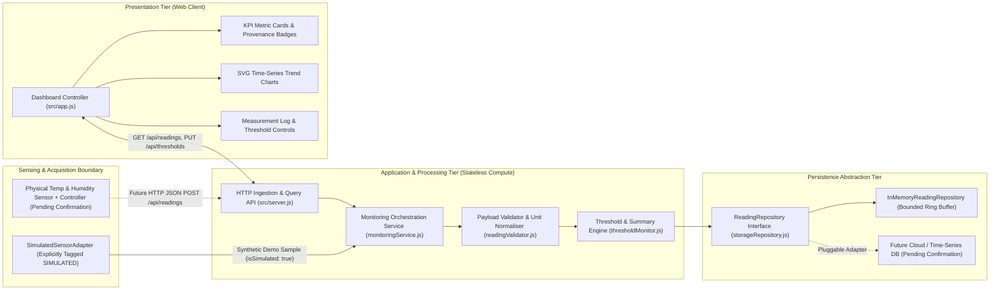

# D. System Architecture

**Project Title:** Environmental Monitoring using Temperature and Humidity Sensors  
**Course:** Cloud Infrastructure and Services (CDIS – 25CS2206E)

---

## 1. Architectural Overview

The Environmental Monitoring system is engineered around a **Modular Multi-Tier Architecture** that separates data acquisition, domain processing, data storage, and user presentation. This separation directly supports two core requirements:

1. **Hardware & Vendor Agnosticism:** Physical sensors, microcontrollers, cloud providers, and databases have not yet been finalised by the team. Isolating ingestion and persistence behind explicit software interfaces ensures zero rework to validation, threshold classification, or UI rendering once hardware and cloud choices are confirmed.
2. **Cloud Infrastructure Alignment (CO1 & CO2):** Stateless request handling, externalised environment configuration, and clean tier boundaries allow the application tier to run locally during development and deploy later onto virtual machines, containers, or serverless functions.

---

## 2. End-to-End Measurement Flow Diagram

A high-resolution vector version of this diagram is stored at [`../diagrams/data-flow-architecture.svg`](../diagrams/data-flow-architecture.svg).

---

## 3. Architectural Tiers Explained

### 3.1 Sensing & Data Acquisition Boundary
- **Role:** Produces raw ambient temperature and relative humidity observations.
- **Current State:** Because physical hardware selection is pending, two adapter classes are defined in `src/components/core/sensorAdapter.js`:
  - `SimulatedSensorAdapter`: Generates bounded synthetic samples strictly stamped with `isSimulated: true` and `source: "SIMULATED_DEMONSTRATION"` for software testing and faculty demonstration.
  - `ExternalIngestAdapter`: Represents external telemetry arriving via `POST /api/readings` as standard JSON, compatible with any Wi-Fi-enabled microcontroller, single-board gateway, or serial-to-HTTP forwarder selected later.

### 3.2 Application & Processing Tier (Compute Layer)
- **Role:** Stateless request handling, input sanitisation, unit normalisation (°C ↔ °F), configurable threshold classification (`NORMAL`, `WARNING`, `ALERT`), statistical aggregation, and runtime health telemetry (`GET /api/health`).
- **Key Property:** Contains no hardcoded device drivers, database connection strings, or UI markup. Configuration is injected via environment variables (`config.js`).

### 3.3 Data Persistence Abstraction Tier
- **Role:** Stores and retrieves evaluated environmental records through the `ReadingRepository` interface (`storageRepository.js`).
- **Current State:** Uses `InMemoryReadingRepository` with a configurable maximum buffer size (`MAX_BUFFER_SIZE`, default `100`) to prevent unbounded memory growth on compute instances. Once the team selects a persistent database, a new repository implementation can be injected into `MonitoringService` without altering API routes or frontend components.

### 3.4 Presentation Tier
- **Role:** Renders environmental conditions clearly and accurately in any standards-compliant browser (`src/index.html`, `src/app.js`, `src/styles/main.css`, and `src/components/reusable/*`).
- **Key Property:** Every displayed metric and log record surfaces both its **environmental severity** and its **data origin** (`SIMULATED` vs `EXTERNAL INGEST`).

---

## 4. Key Architectural Quality Attributes

| Attribute | Design Mechanism |
| :--- | :--- |
| **Modularity** | Distinct ES modules for config, validation, threshold evaluation, adapters, storage, and UI widgets |
| **Portability** | Zero external npm dependencies; runs on any Node.js v20+ VM, container, or local workstation |
| **Configurability** | `.env` / environment variables control host, port, operating mode, validation bounds, and normal thresholds |
| **Data Integrity** | Strict numeric checks, plausible range filtering, and mandatory simulation provenance flags |
| **Security Hygiene** | Optional bearer/header ingestion token support (`INGEST_API_TOKEN`), HTML escaping, path traversal prevention, `.gitignore` secret exclusion |
