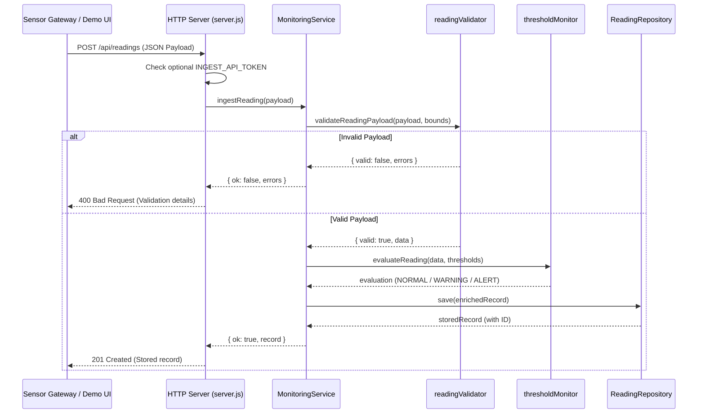

# E. System Design

**Project Title:** Environmental Monitoring using Temperature and Humidity Sensors  
**Course:** Cloud Infrastructure and Services (CDIS – 25CS2206E)

---

## 1. Module Decomposition and Responsibilities

All active source code resides inside `src/` and is organised into **Core Application Modules** (`src/components/core/`), **Reusable Presentation Components** (`src/components/reusable/`), and **Entry Controllers** (`src/server.js`, `src/app.js`, `src/index.html`).

### 1.1 Core Application Modules (`src/components/core/`)

| Module | Primary Exports | Responsibility |
| :--- | :--- | :--- |
| `config.js` | `loadConfig()`, `getPublicConfig()`, `parseEnvFile()` | Reads `.env` and `process.env` settings; provides safe defaults; strips secret tokens before returning public configuration |
| `readingValidator.js` | `validateReadingPayload()`, `celsiusToFahrenheit()`, `fahrenheitToCelsius()` | Validates incoming JSON payloads, enforces finite numeric types and physical plausibility bounds, normalises timestamps, and assigns provenance flags |
| `thresholdMonitor.js` | `evaluateReading()`, `validateThresholds()`, `computeSummaryStatistics()` | Classifies temperature and humidity values against normal/warning/critical bounds and computes min, max, mean, and count breakdowns |
| `sensorAdapter.js` | `SensorDataSource`, `SimulatedSensorAdapter`, `ExternalIngestAdapter` | Defines the data-source contract; generates explicitly labelled synthetic demo readings when operating in `SIMULATION` mode |
| `storageRepository.js` | `ReadingRepository`, `InMemoryReadingRepository` | Defines the persistence contract; implements a bounded FIFO ring buffer with buffer utilisation metrics |
| `monitoringService.js` | `MonitoringService` | Coordinates validation, threshold classification, simulation seeding, threshold updates (with retroactive buffer re-evaluation), and dashboard snapshots |

### 1.2 Reusable Presentation Components (`src/components/reusable/`)

| Component | Primary Exports | Responsibility |
| :--- | :--- | :--- |
| `formatters.js` | `escapeHtml()`, `formatTemperature()`, `formatHumidity()`, `formatTimestamp()`, `formatStateLabel()` | Provides consistent unit formatting and XSS-safe HTML escaping across all UI views |
| `statusBadge.js` | `renderSeverityBadge()`, `renderOriginBadge()` | Renders semantic severity badges (`NORMAL`, `WARNING`, `ALERT`) and provenance pills (`SIMULATED`, `EXTERNAL INGEST`) |
| `metricCard.js` | `renderMetricCard()` | Renders standardised KPI summary cards with SVG icons, primary/secondary metrics, and statistical footers |
| `trendChart.js` | `renderTrendCharts()` | Generates responsive native SVG line charts for temperature and relative humidity with shaded normal threshold bands |
| `readingsTable.js` | `renderReadingsTable()` | Renders the timestamped environmental measurement log table and empty-state guidance |
| `thresholdForm.js` | `renderThresholdFields()` | Renders editable form controls for normal bounds and critical margins |

---

## 2. Canonical Environmental Payload Schema

To avoid locking into any specific sensor model or microcontroller library, the ingestion API accepts a clean, vendor-neutral JSON structure:

### Request Payload (`POST /api/readings`)

```json
{
  "sensorId": "LAB-NODE-01",
  "zone": "Cleanroom Zone A",
  "temperatureC": 23.8,
  "humidityPct": 49.2,
  "timestamp": "2026-11-25T10:15:00.000Z",
  "isSimulated": false,
  "note": "Periodic ambient observation"
}
```

- Either `temperatureC` or `temperatureF` may be supplied; both Celsius and Fahrenheit representations are stored after normalisation.
- `sensorId`, `zone`, `timestamp`, and `note` are optional (sensible defaults are applied if omitted).
- `isSimulated` defaults to `false` on `POST /api/readings` and is forced to `true` on `POST /api/simulate`.

### Stored & Enriched Record Structure

```json
{
  "id": "RD-00001",
  "sensorId": "LAB-NODE-01",
  "zone": "Cleanroom Zone A",
  "temperatureC": 23.8,
  "temperatureF": 74.84,
  "humidityPct": 49.2,
  "timestamp": "2026-11-25T10:15:00.000Z",
  "isSimulated": false,
  "source": "EXTERNAL_SENSOR_INGEST",
  "note": "Periodic ambient observation",
  "evaluation": {
    "overallSeverity": "NORMAL",
    "temperatureState": "NORMAL",
    "humidityState": "NORMAL",
    "advisoryMessage": "Temperature and relative humidity are within normal operating limits."
  }
}
```

---

## 3. Threshold Classification Logic

For any metric $x$ with configured normal minimum $L_{\min}$, normal maximum $L_{\max}$, and critical margin $\Delta_{\text{crit}} > 0$:

| Condition | Metric State | Mapped Severity |
| :--- | :--- | :--- |
| $x \le L_{\min} - \Delta_{\text{crit}}$ | `LOW_ALERT` | `ALERT` |
| $L_{\min} - \Delta_{\text{crit}} < x < L_{\min}$ | `LOW_WARNING` | `WARNING` |
| $L_{\min} \le x \le L_{\max}$ | `NORMAL` | `NORMAL` |
| $L_{\max} < x < L_{\max} + \Delta_{\text{crit}}$ | `HIGH_WARNING` | `WARNING` |
| $x \ge L_{\max} + \Delta_{\text{crit}}$ | `HIGH_ALERT` | `ALERT` |

The overall record severity is determined by taking the maximum severity rank across temperature and relative humidity:

$$\text{Severity}_{\text{overall}} = \max\left(\text{Severity}_{\text{temp}}, \text{Severity}_{\text{humidity}}\right)$$

---

## 4. REST API Specification (`src/server.js`)

| Method & Route | Purpose | Success Code | Error Codes |
| :--- | :--- | :--- | :--- |
| `GET /api/health` | Returns service status, uptime, Node memory/CPU info, and buffer utilisation | `200 OK` | — |
| `GET /api/config` | Returns sanitised runtime configuration (never exposes `INGEST_API_TOKEN`) | `200 OK` | — |
| `GET /api/readings?limit=N` | Returns latest readings, summary statistics, active thresholds, and buffer stats | `200 OK` | — |
| `POST /api/readings` | Validates, evaluates, and stores an environmental payload | `201 Created` | `400`, `401`, `413` |
| `POST /api/simulate` | Generates a clearly labelled `SIMULATED` demonstration reading | `201 Created` | `403` (if `EXTERNAL_INGEST`) |
| `PUT /api/thresholds` | Updates normal/critical bounds and re-evaluates buffered measurements | `200 OK` | `400` |
| `DELETE /api/readings` | Clears buffered session measurements | `200 OK` | — |

---

## 5. Request Processing Sequence


