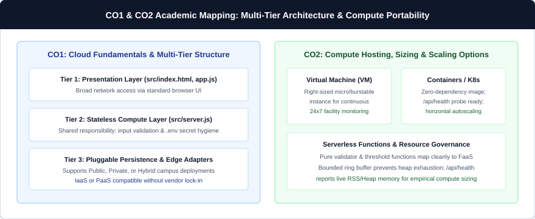
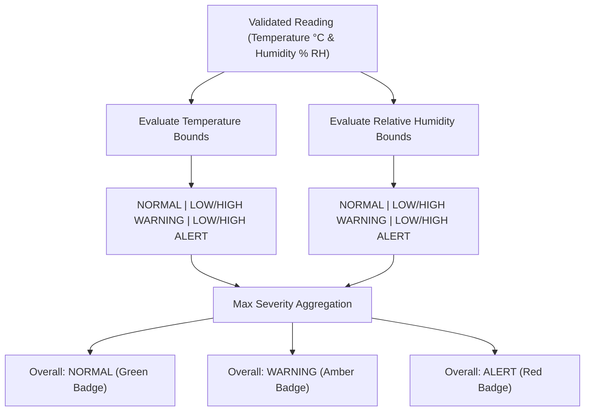

# Architecture & Flow Diagrams Catalogue

**Project:** Environmental Monitoring using Temperature and Humidity Sensors  
**Course:** Cloud Infrastructure and Services (CDIS – 25CS2206E)

---

## 1. End-to-End Environmental Measurement Flow (`data-flow-architecture.svg`)

Illustrates how simulated demonstration readings (`SimulatedSensorAdapter`) and future physical microcontroller telemetry (`ExternalIngestAdapter`) pass through stateless HTTP validation, configurable threshold classification, pluggable persistence, and the web presentation dashboard.

---

## 2. Multi-Tier & CO1/CO2 Compute Portability Diagram (`multi-tier-cloud-mapping.svg`)

Illustrates how the three software tiers map onto CO1 architectural concepts and CO2 compute execution models (Virtual Machines, Containers/Kubernetes, and Serverless Functions).

---

## 3. Environmental Severity State Classification Diagram

