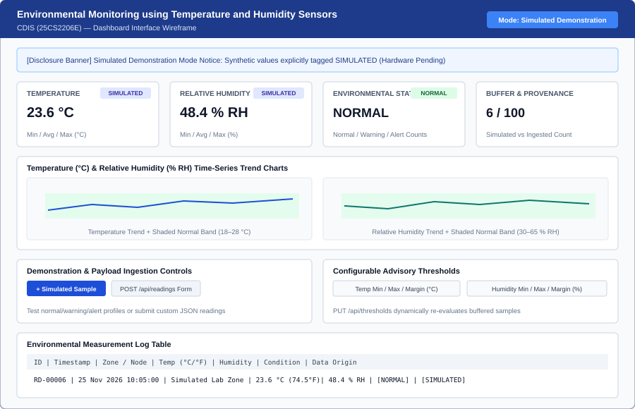

# Dashboard Wireframe & UI Presentation Notes

**Project:** Environmental Monitoring using Temperature and Humidity Sensors  
**Course:** Cloud Infrastructure and Services (CDIS – 25CS2206E)

---

## 1. Wireframe Reference

---

## 2. Layout & Academic Design Rationale

1. **Top Institutional Header:**  
   Displays the exact project title, course code (`25CS2206E`), active operating mode (`Simulated Demonstration` vs `External Sensor Ingest`), and API connection status.

2. **Mandatory Simulation Disclosure Banner:**  
   Positioned immediately below the header whenever synthetic data is active so faculty reviewers can verify at a glance that simulated demonstration data is never conflated with physical sensor readings.

3. **Four-Column KPI Summary Grid:**  
   Surfaces instantaneous Temperature (`°C` and `°F`), Relative Humidity (`% RH`), Evaluated Environmental Condition (`NORMAL`, `WARNING`, `ALERT`), and Ring-Buffer Utilisation (`bufferedCount / maxBufferSize`) with rolling minimum, mean, and maximum footers.

4. **Side-by-Side SVG Time-Series Plots:**  
   Uses clean vector polylines overlaid on green shaded normal operating bands (`tempMinNormalC`–`tempMaxNormalC` and `humidityMinNormalPct`–`humidityMaxNormalPct`), avoiding heavy third-party charting dependencies and excessive animations.

5. **Interactive Verification & Threshold Controls:**  
   Provides simulation scenario buttons, a vendor-neutral `POST /api/readings` submission form, and live threshold configuration fields (`PUT /api/thresholds`).

6. **Provenance-Tagged Measurement Log:**  
   Lists chronological records newest-first with colour-coded semantic condition badges and explicit `SIMULATED` / `EXTERNAL INGEST` origin pills.
